


**Viloyatdagi bozorlar, turargohlar, to'yxonalar, karyerlar va hosil qabul punktlarini bitta markazdan real vaqtda kuzatish tizimi:** tushum, oqim, kamera holati va aloqa uzilishi bir ekranda ko'rinadi, muammo bo'lsa Telegram orqali xabar keladi.

---

## Bir qarashda

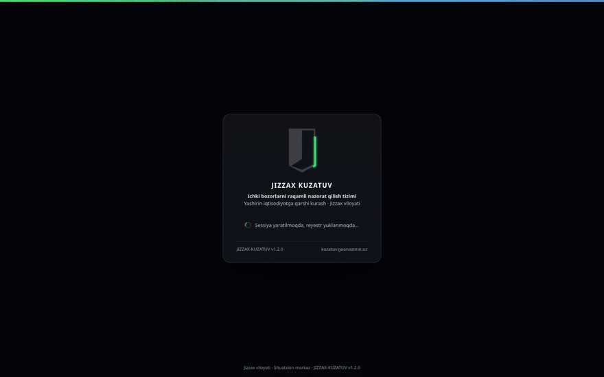

Har bir obyekt (bozor kassasi, turargoh shlagbaumi, karyer tarozisi) markazga o'z ma'lumotini yuboradi. Markaz obyektni to'rt holatdan birida ko'rsatadi:

| Holat | Ma'nosi |
|---|---|
| 🟢 **Onlayn** | Ma'lumot kelyapti, kameralar javob beryapti |
| 🟡 **Nosozlik** | Obyekt ishlayapti, lekin kameralarning bir qismi jim |
| 🔴 **Oflayn** | 180 soniyadan beri aloqa yo'q. Raqamlar uzilish paytida «muzlaydi», Telegram'ga xabar ketadi |
| ⚪ **Ulanmagan** | Obyekt reyestrda bor, hali ulanmagan. Uning raqami **ko'rsatilmaydi** (0 emas) |

**Halollik qoidasi:** manbasi yo'q ko'rsatkich hech qachon «0» bo'lib chiqmaydi, uning o'rnida «—» va «manba yo'q» yoziladi. Aks holda nol «hammasi naqd» yoki «hech kim kelmadi» deb o'qilishi mumkin edi.

## Asosiy imkoniyatlar

| | |
|---|---|
| 🏪 **7 xil obyekt** | Oziq-ovqat bozori, avtoturargoh, to'yxona, chorva bozori, karyer, mashina bozori, jarima maydonchasi. Yangi bo'lim panelning o'zidan qo'shiladi (nom, prefiks, xulq-shablon, shakl, rang), dasturchi kerak emas |
| 🔌 **Vendor API** | Kassa, ANPR yoki CRM dasturi har hodisada bitta so'rov yuboradi: `POST /api/v1/hodisa`. Bearer token, ixtiyoriy HMAC imzo, takroriy chek ikki marta sanalmaydi (409). Eski kassalar uchun oddiy GET-havola ham bor |
| 📷 **Kamera nazorati** | Obyekt kompyuteridagi agent 12 belgili faollashtirish kaliti bilan ulanadi. Har kameradan 45 soniyada bitta kadr keladi, kamera ochilganda jonli rejimga o'tadi. Video markazda saqlanmaydi |
| ⛰️ **Karyer: pulsiz nazorat** | Karyerda pul ko'rsatilmaydi, chunki uning ishonchli manbasi yo'q. Buning o'rniga yuk (tonna), reyslar va **hujjatsiz chiqishlar** kuzatiladi. Hujjatsiz chiqqan mashina qizil rangda turadi |
| 🚗 **Avtoturargoh** | Kirdi, chiqdi, ichkarida turgan mashinalar, tushum va to'lov usuli. Sig'imi to'ldirilmagan obyektda bandlik foizi chiqmaydi |
| 🌾 **Hosil qabuli** | Paxta va g'alla qabul punktlari: tarozi (COM port), 4 kamera, har tortishning brutto, tara va netto chizig'i, 14 ta avtomatik tekshiruv. Punkt agenti internet uzilganda navbatda saqlaydi |
| 🏛️ **Situatsion markaz** | Elektr, gaz, suv, ijtimoiy himoya, bandlik va murojaatlar tuman kesimida. Uzilishlar reyestri va xaritasi, topshiriqlar va ularning muddati |
| 👥 **6 rol** | Super admin, admin, tuman hisobi, soha tashkiloti, kuzatuvchi, murojaat operatori. Tuman hisobi faqat o'z tumanini ko'radi, filtr **serverda** ishlaydi (jonli oqim ham) |
| 🔐 **Xavfsizlik** | Telegram orqali ikki bosqichli kirish, sessiyani masofadan uzish, urinishlar cheklovi, CSV ga chiqariladigan audit jurnali |
| 📈 **Bozor lentasi** | Markaziy bank kurslari va tovar-xomashyo birjasi narxlari panel tepasida yuguradi |

## Ekranlar

<table>
<tr>
<td width="50%">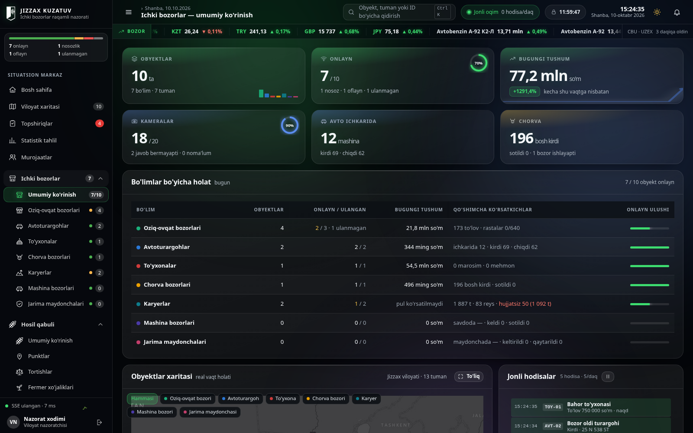 <b>Ichki bozorlar</b> — bo'limlar bo'yicha holat, bugungi tushum, jonli hodisalar</td>
<td width="50%">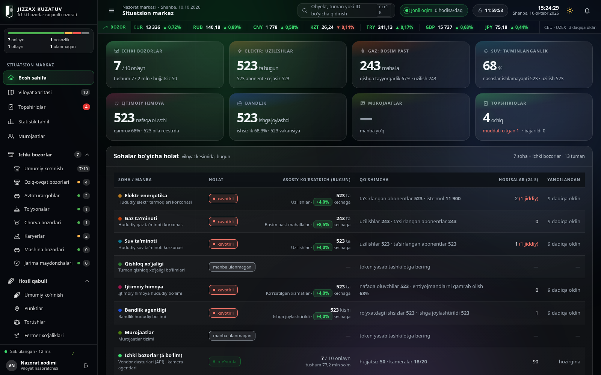 <b>Situatsion markaz</b> — kommunal va ijtimoiy sohalar tuman kesimida</td>
</tr>
<tr>
<td>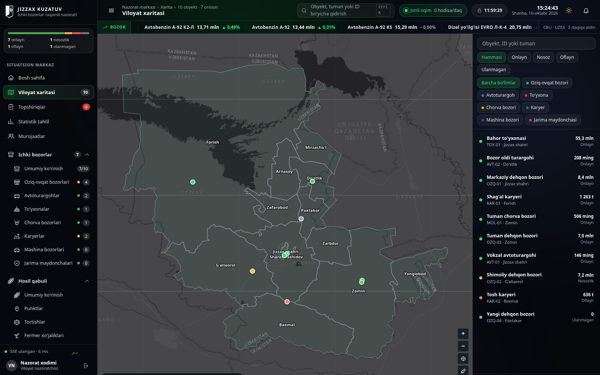 <b>Viloyat xaritasi</b> — sputnik qatlami, obyektlar holat va tur bo'yicha</td>
<td>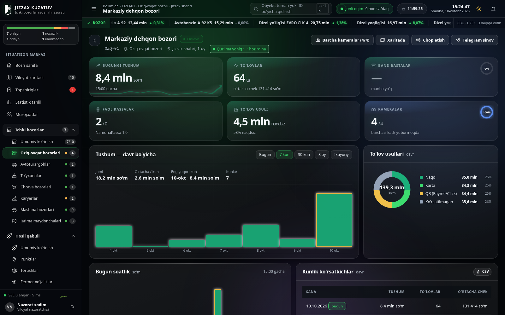 <b>Bozor sahifasi</b> — tushum, to'lov usullari, 7/30/90 kunlik taqqoslash</td>
</tr>
<tr>
<td>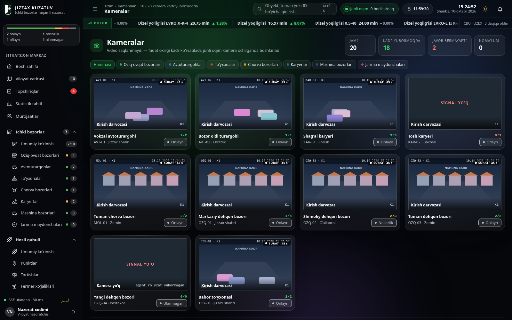 <b>Kameralar</b> — oxirgi kadr va kamera holati (suratlar sxematik namuna)</td>
<td>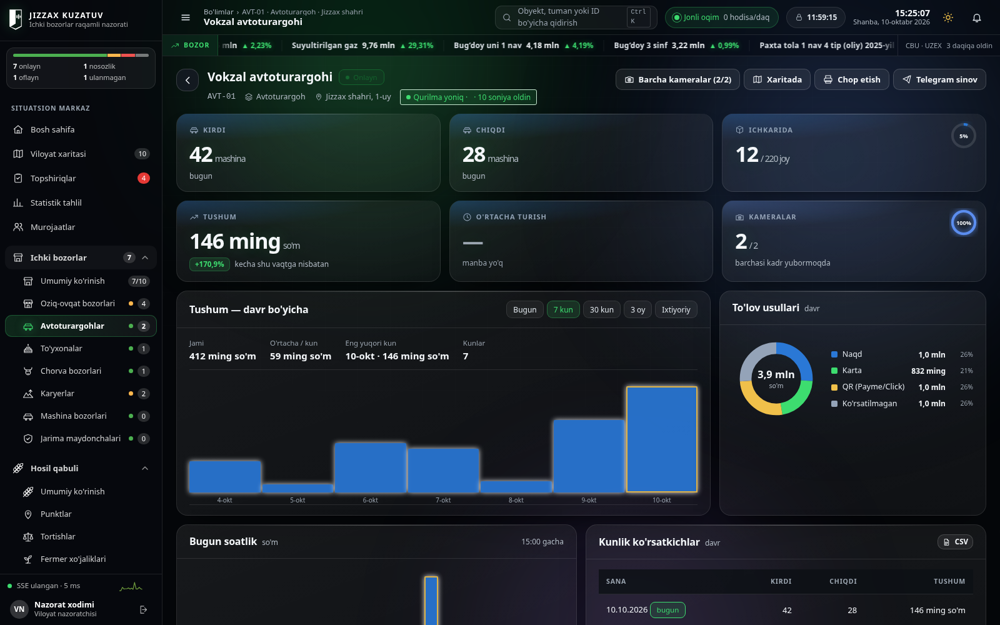 <b>Avtoturargoh</b> — kirdi, chiqdi, ichkarida, tushum</td>
</tr>
<tr>
<td>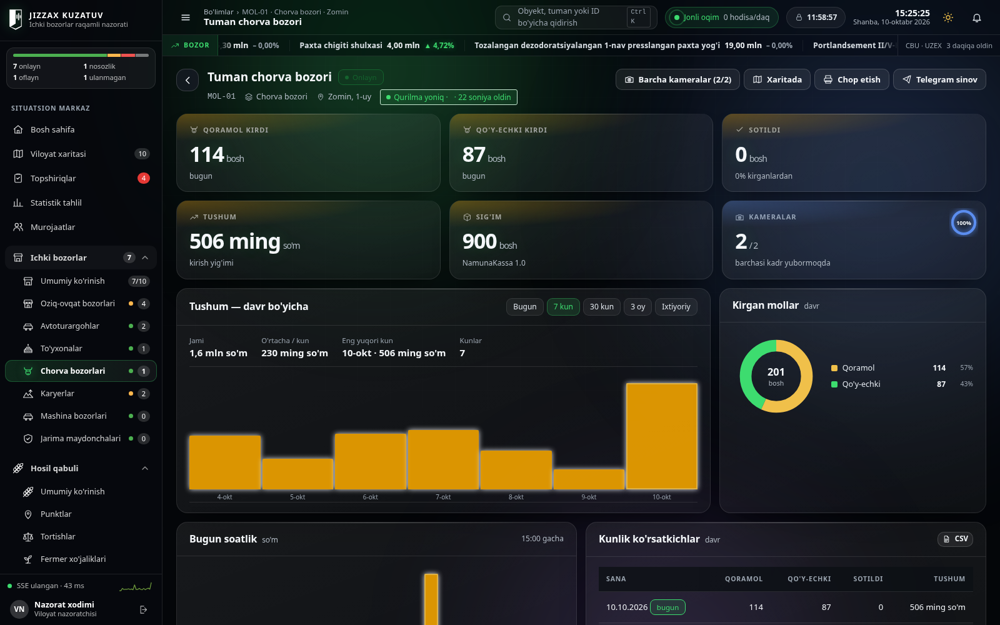 <b>Chorva bozori</b> — kirgan mollar, kirish yig'imi</td>
<td>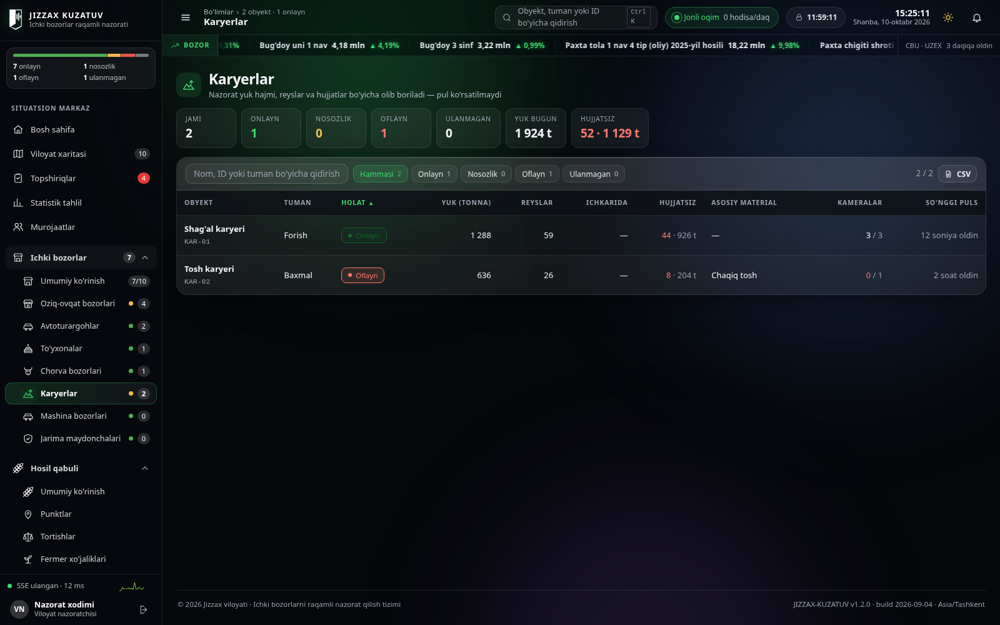 <b>Karyerlar</b> — tonna, reys, hujjatsiz chiqish (pul ko'rsatilmaydi)</td>
</tr>
<tr>
<td>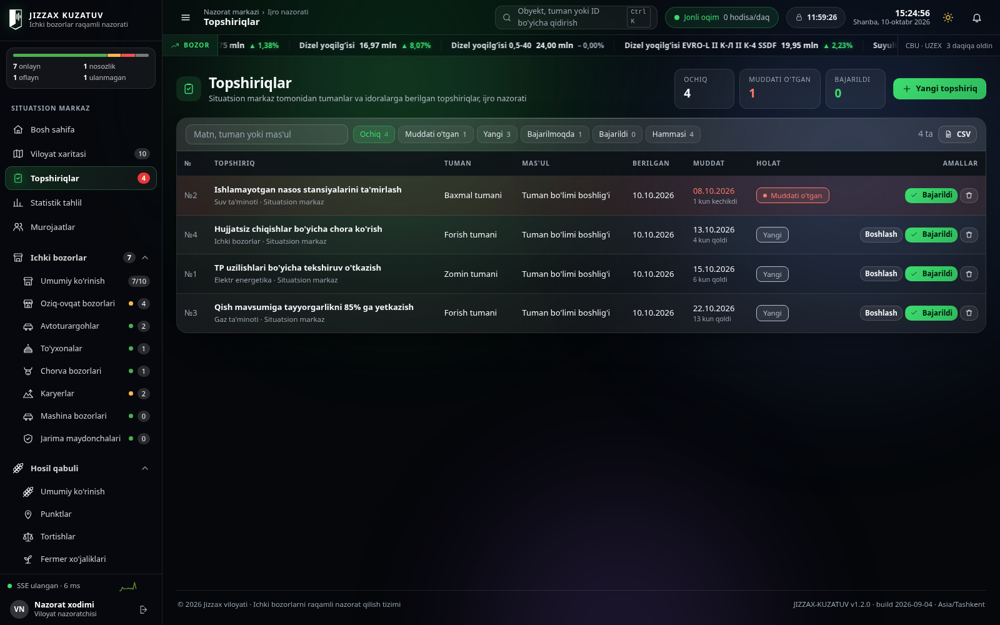 <b>Topshiriqlar</b> — mas'ul, muddat, ijro holati</td>
<td>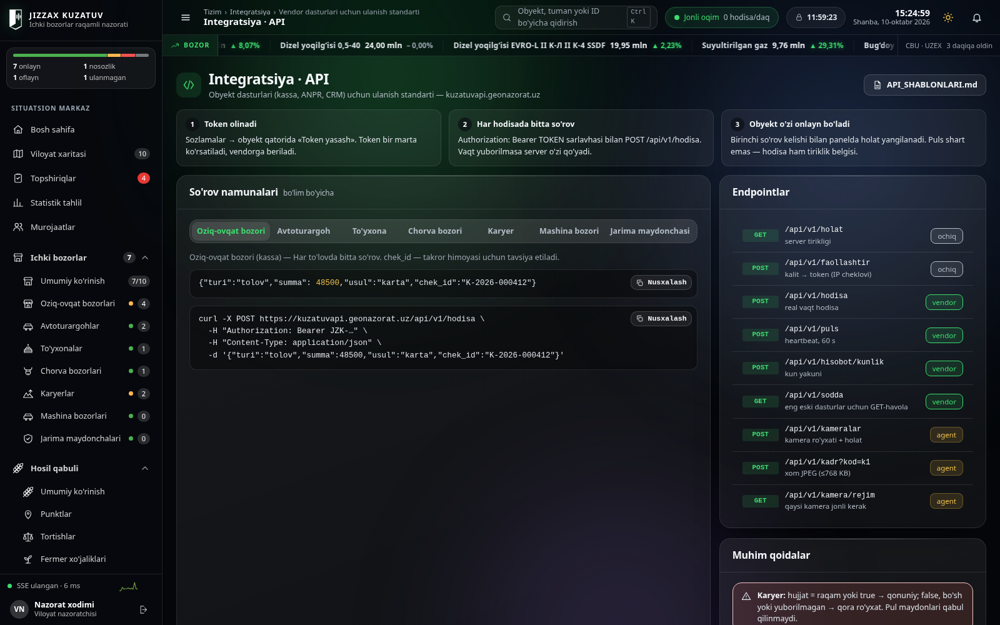 <b>Integratsiya · API</b> — har bo'lim uchun tayyor so'rov namunasi</td>
</tr>
<tr>
<td>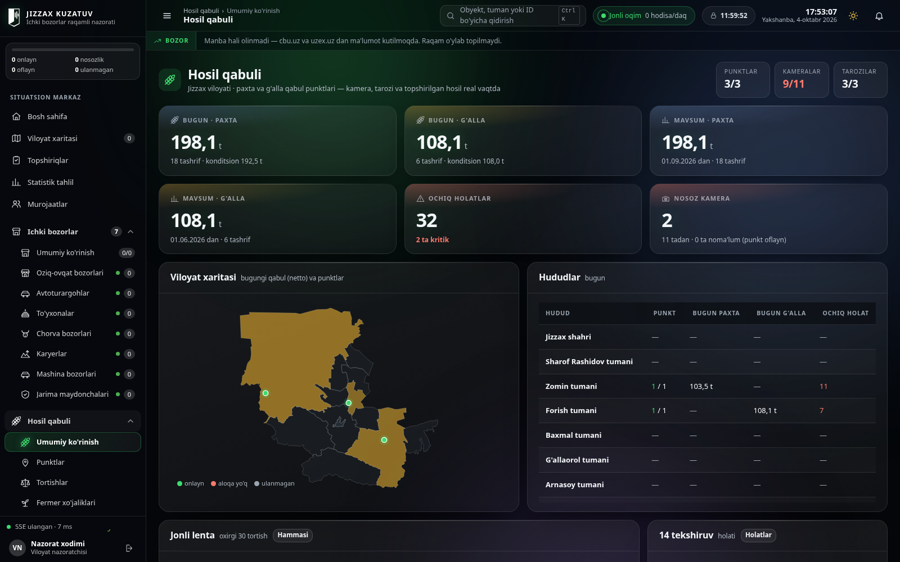 <b>Hosil qabuli</b> — punktlar, bugungi qabul, ochiq holatlar</td>
<td>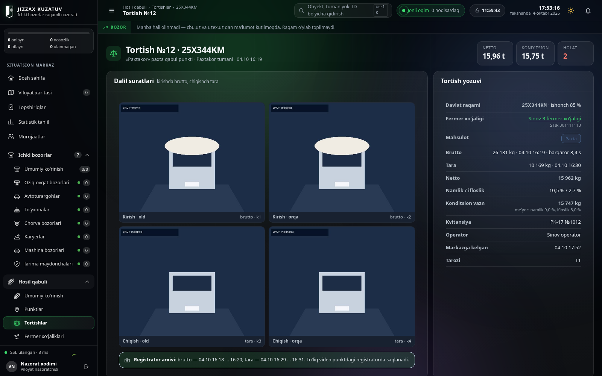 <b>Tortish kartasi</b> — 4 kamera dalili, brutto/tara, namlik va konditsion vazn</td>
</tr>
<tr>
<td colspan="2">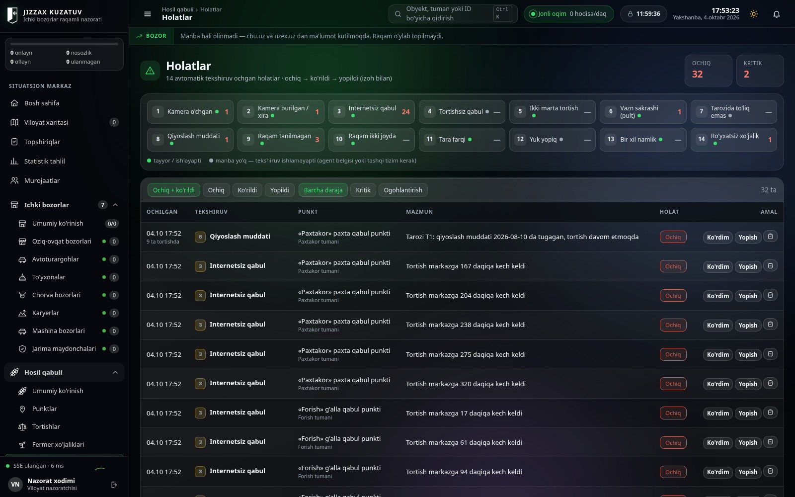 <b>14 avtomatik tekshiruv</b> — kamera o'chgan, internetsiz qabul, qiyoslash muddati o'tgan, raqam tanilmagan va boshqalar</td>
</tr>
</table>

> Suratlardagi barcha obyektlar, raqamlar, davlat raqamlari va fermer nomlari **namuna ma'lumot**. Kamera kadrlari sxematik rasm.

## Arxitektura

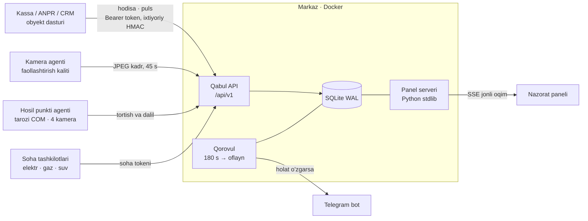

- **Tashqi kutubxonasiz server:** faqat Python standart kutubxonasi (`ThreadingHTTPServer`, `sqlite3`). Panel — bitta HTML fayl, freymvorksiz JavaScript.
- **Ikki domen, bitta jarayon:** panel va qabul API alohida domenda, Caddy orqasida bitta konteynerga boradi. Konteyner tashqariga port ochmaydi.
- **Yangi bo'lim — alohida fayl:** masalan, «Hosil qabuli» panel shabloniga tegmasdan alohida JS modul sifatida ulanadi.

## Sifat

**964 ta avtomatik sinov, 0 xato** (toza vaqtinchalik bazada ishga tushirib sanaldi):

| To'plam | Sinov |
|---|---:|
| Regressiya (butun zanjir) | 45 |
| Telegram ogohlantirishlari (soxta bot serveri bilan) | 28 |
| Qabul API | 151 |
| Baza | 125 |
| Rol, sessiya, token, audit | 150 |
| Fuqaro murojaatlari | 44 |
| Tashqi manbalar | 31 |
| Elektr tarmog'i | 48 |
| Statistika va tahlil | 36 |
| Bozor lentasi | 53 |
| Panel (headless Chrome) | 153 |
| Hosil qabuli API | 63 |
| Hosil punkti agenti (virtual COM port) | 37 |

- Baza auditi jamlanma raqamlarini **mustaqil SQL** bilan qayta hisoblab solishtiradi: kod o'zini o'zi tasdiqlamaydi.
- Panel auditi ekrandagi raqamlarni server javobi bilan solishtiradi va sessiya davomida JS xatosi yo'qligini tekshiradi.

## Texnologiyalar

Python 3.12 (stdlib) · SQLite (WAL) · Server-Sent Events · vanilla JavaScript + SVG · Esri sputnik qatlami · Docker + Caddy · Telegram Bot API · ffmpeg (punkt agenti) · Playwright (sinovlar)

## Jonli

🌐 [kuzatuv.geonazorat.uz](https://kuzatuv.geonazorat.uz) — xizmat kirishi (login talab qilinadi)

---

**Manba kodi yopiq.** Namoyish yoki hamkorlik bo'yicha: Telegram [@Humoyun_Davronov](https://t.me/Humoyun_Davronov)

Muallif — Humoyun Davronov

